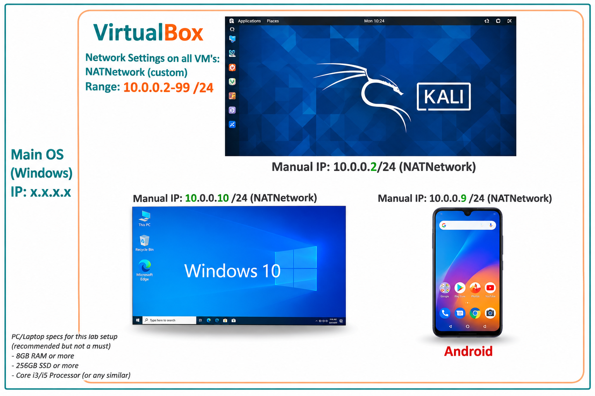
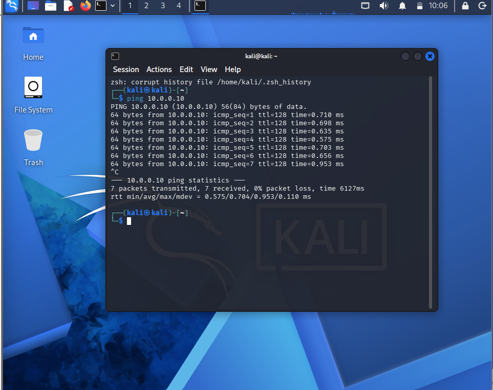
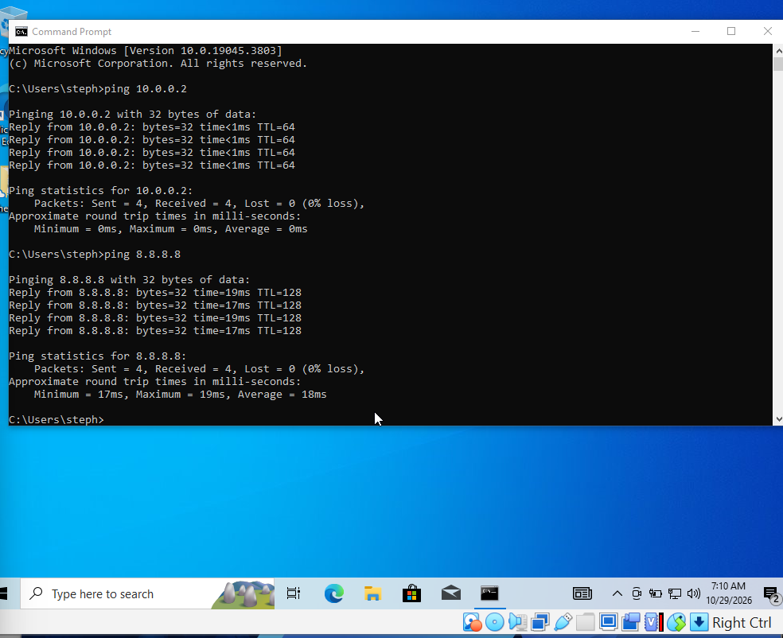
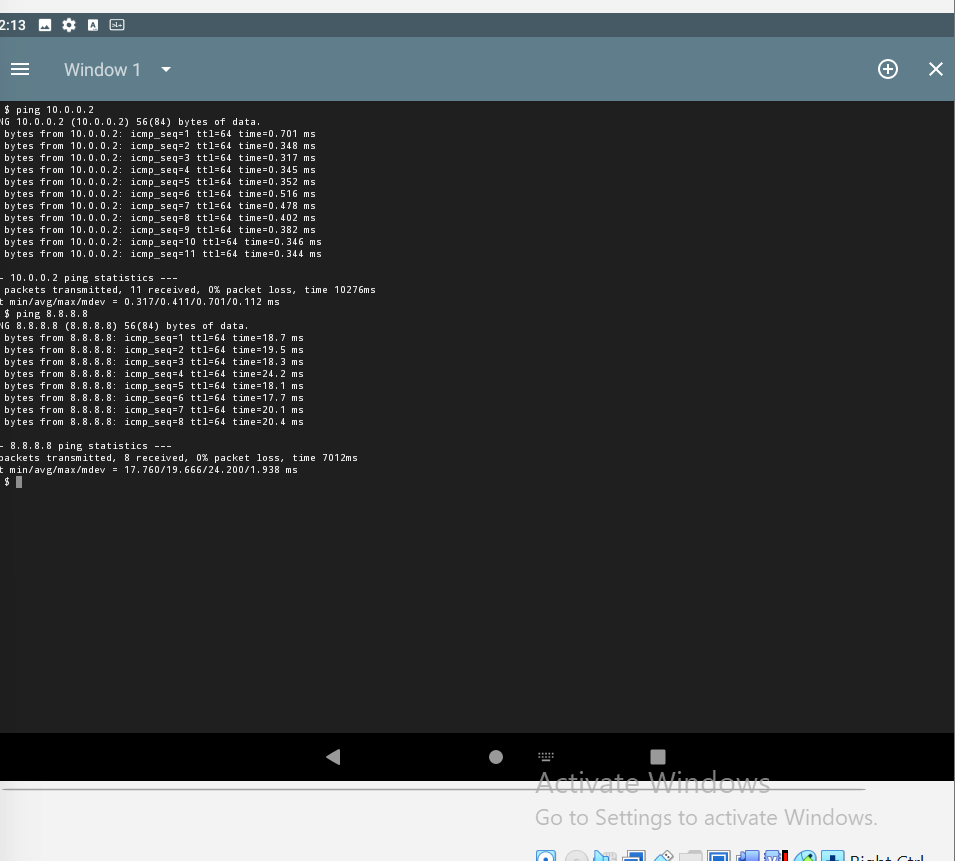
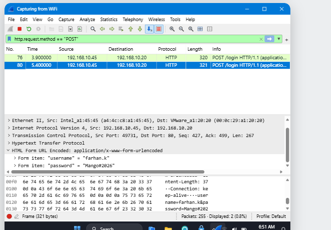
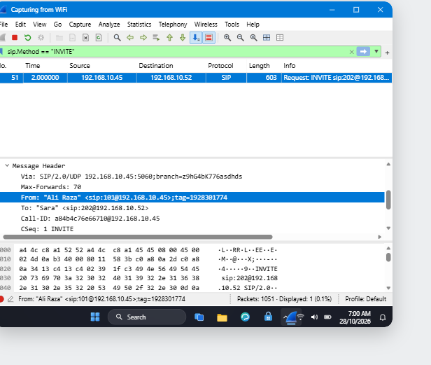
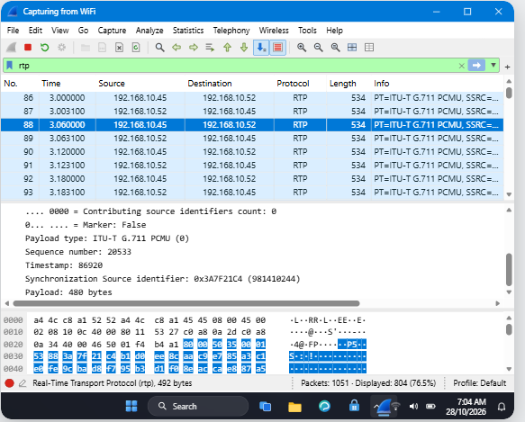
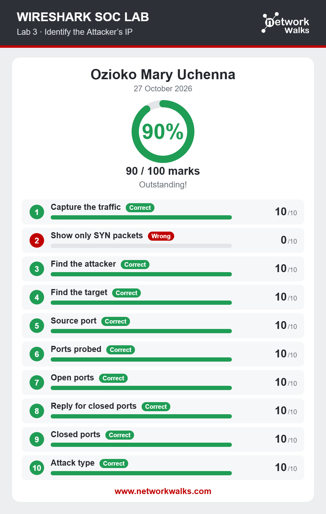
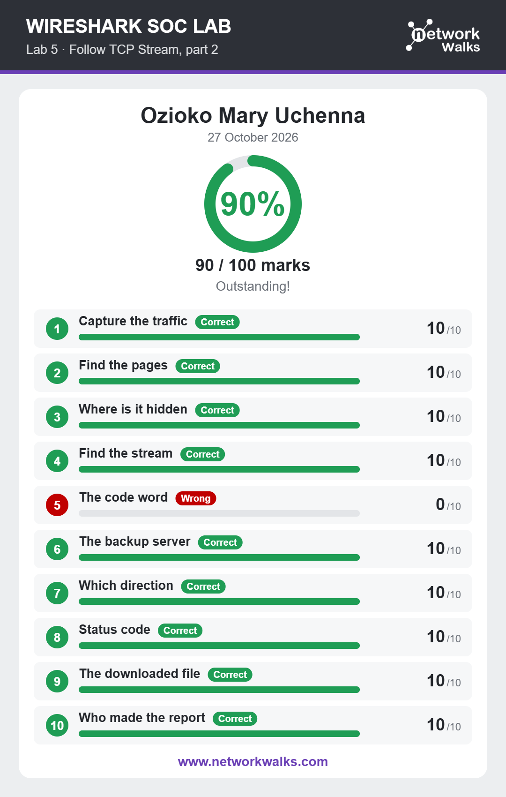

[README.md](https://github.com/user-attachments/files/34142033/README.md)


# 🔐 Cybersecurity Lab Environment: Week 1

**Building a virtual lab in VirtualBox and analysing network traffic with Wireshark**


---

## 📌 Project Overview

This project covers my Week 1 work in the NetworkWalks cybersecurity internship training. I built a small virtual laboratory in VirtualBox, with Kali Linux, Windows 10 and Android-x86 on one private NAT Network, and then used Wireshark to analyse attack traffic and plain-text data in six SOC labs.

The lab gives me a safe, repeatable place to practise networking, troubleshooting and traffic analysis.

---

## 🎯 Objectives

The main objectives of this project are to:

- Create a private **NAT Network** in VirtualBox for the lab.
- Build a Windows 10 virtual machine and connect it to Kali Linux.
- Build an Android 9.0 (Android-x86) virtual machine on the same network.
- Assign static IPv4 addresses to the lab machines.
- Verify connectivity between the machines and to the internet.
- Troubleshoot connectivity problems methodically.
- Complete six Wireshark SOC labs (60 tasks) and document what I found.

---

## 🛡️ Purpose of the Lab

The lab provides an isolated environment for cybersecurity learning. It can be used for activities such as:

- Network reconnaissance and port scanning
- Packet analysis
- Spotting brute-force attacks and plain-text credentials
- VoIP call analysis
- Testing connectivity and firewall rules

⚠️ **Important:** This lab must only be used on systems that I own or have permission to test. All traffic analysed in the Wireshark section comes from training labs.

---

## 🏗️ Lab Architecture



Additional machines can be added to the same virtual network in future projects.

---

## ⚙️ Lab Configuration

| 🧩 Component | ⚙️ Configuration |
|---|---|
| 🧰 Hypervisor | Oracle VirtualBox |
| 🐉 Security OS | Kali Linux |
| 🪟 Windows machine | Windows 10 |
| 🤖 Android machine | Android-x86 9.0-r2 (64-bit), 2048 MB RAM, 16.8 GB dynamically allocated VDI disk |
| 🌐 Virtual Network | NAT Network |
| 📡 Network Address | 10.0.0.0/24 |
| 🐧 Kali IP Address | 10.0.0.2/24 |
| 🤖 Android IP Address | 10.0.0.9/24 |
| 🪟 Windows 10 IP Address | 10.0.0.10/24 |
| 🚪 Default Gateway | 10.0.0.1 |
| 🌍 DNS Server | 8.8.8.8 |
| 🔎 Traffic analysis | Wireshark |

---

# 🪜 Lab Setup Procedure

## Part A. Windows 10 and Kali Linux

### Step 1. Create the Windows 10 virtual machine

I downloaded the Windows 10 installation ISO, created a new virtual machine in VirtualBox, and installed and configured Windows 10.

### Step 2. Configure the NAT Network

I created and configured a NAT Network so the virtual machines can talk to each other and reach the internet. The Windows 10 adapter was set to **Attached to: NAT Network**, using the same network as Kali.

### Step 3. Assign static IP addresses

```
Kali Linux:  10.0.0.2/24
Windows 10:  10.0.0.10/24
Gateway:     10.0.0.1
DNS:         8.8.8.8
```

### Step 4. Test connectivity

From Kali Linux I tested Windows 10, and from Windows 10 I tested Kali and the internet, using the `ping` command.

```
ping 10.0.0.10    (Kali to Windows 10)
ping 10.0.0.2     (Windows 10 to Kali)
ping 8.8.8.8      (Windows 10 to the internet)
```





---

## Part B. Android-x86 in VirtualBox

### Step 1. Download the ISO

I downloaded `android-x86_64-9.0-r2.iso` from the official Android-x86 release page.

### Step 2. Create the virtual machine

```
Name:    Android9-Lab
Type:    Linux (64-bit)
RAM:     2048 MB
Disk:    VDI, dynamically allocated, 16.8 GB
Display: Video memory 64 MB, VBoxVGA, 3D acceleration off
```

### Step 3. Install Android to the virtual disk

I attached the ISO and chose **Installation - Install Android-x86 to harddisk**. I then created a bootable primary partition, formatted it as **ext4**, and answered **Yes** to GRUB and to the read-write `/system` directory. After removing the ISO, Android started from the hard disk through the GRUB menu.

### Step 4. Put Android on the NAT Network

The VM's network adapter was set to **Attached to: NAT Network**, using the same network as Kali.

### Step 5. Set a static IP inside Android

Android-x86 shows the VirtualBox network card as a Wi-Fi network called **VirtWifi**. I set a static IP on it:

```
IP address:            10.0.0.9
Gateway:               10.0.0.1
Network prefix length: 24 (255.255.255.0)
DNS 1:                 8.8.8.8
```

### Step 6. Test connectivity

```
ping 10.0.0.2     (Android to Kali)
ping 8.8.8.8      (Android to the internet)
ping 10.0.0.9     (Kali to Android)
```



---

## Part C. Wireshark SOC Labs

I completed six SOC labs from NetworkWalks. Each lab has a packet capture and 10 tasks, so I worked through 60 tasks in total.

| Lab | Scenario | Key finding |
|---|---|---|
| 1 | Identify the attacker's IP | TCP SYN port scan from 192.168.10.66 against 192.168.10.20: 40 ports probed, ports 22, 80 and 443 open |
| 2 | Follow TCP Stream 1 | A plain-text office chat on TCP port 5000 leaked a temporary password and a Wi-Fi password |
| 3 | Follow TCP Stream, Part 2 | A hidden HTML comment on /staff.html exposed an access code and a backup server IP |
| 4 | HTTP plain-text credentials | A login sent over HTTP showed the username and password in the packet |
| 5 | Catch the brute-force attacker | FTP brute force: 25 passwords tried for one username, 24 failed logins, then one success |
| 6 | Catch the call scammer | A SIP call setup traced to an unencrypted RTP voice stream using the G.711 PCMU codec |

**Filters and tools I used**

```
tcp.flags.syn == 1 && tcp.flags.ack == 0
ftp.response.code == 530
http.request.method == "POST"
http.file_data contains "<!--"
sip.Method == "INVITE"
rtp
```

Statistics → Conversations, Statistics → Protocol Hierarchy, and Analyze → Follow → TCP Stream.

**HTTP plain-text credentials (Lab 4):** the POST login showed the username and password in the packet.



**VoIP call (Lab 6):** the SIP INVITE showed who made the call.



**VoIP call (Lab 6):** the RTP packets carried the voice using the G.711 PCMU codec.



**NetworkWalks result cards**

Lab 1 here is NetworkWalks Lab 3, and Lab 3 here is NetworkWalks Lab 5.





---

# 🔎 Lab Verification

| ✅ Test | 🧾 Command | 🎯 Result |
|---|---|---|
| 🪟 Kali to Windows 10 | `ping 10.0.0.10` | Packets sent and received, no packets lost |
| 🪟 Windows 10 to Kali | `ping 10.0.0.2` | Packets sent and received, no packets lost |
| 🌍 Windows 10 to the internet | `ping 8.8.8.8` | Packets sent and received, no packets lost |
| 🤖 Android to Kali | `ping 10.0.0.2` | Packets sent and received, no packets lost |
| 🌍 Android to the internet | `ping 8.8.8.8` | Packets sent and received, no packets lost |
| 🐉 Kali to Android | `ping 10.0.0.9` | Packets sent and received, no packets lost |
| 🌐 Check Kali IP address | `ip a` | 10.0.0.2/24 on eth1 |

---

# 🐞 Problems Encountered & Solutions

## Problem 1. Ping to Windows 10 did not work at first

The IP addresses were correct, but pings from Kali to Windows 10 failed. A Windows firewall rule was affecting incoming ICMP echo requests.

**Solution:** I changed the rule so Windows allows incoming ICMP echo requests, then tested again with `ping`.

## Problem 2. Android ran in Live CD mode

The first start showed the Android home screen, but it was running straight from the ISO. Removing the ISO gave "no bootable medium found", so nothing had been saved.

**Solution:** I started again from the ISO and chose **Installation - Install Android-x86 to harddisk**, then completed the partition and install steps.

## Problem 3. Android stopped at a text prompt

After installation Android stopped at `console:/ #` instead of the home screen, even though `ls /system` showed the Android files were installed.

**Solution:** I set the Graphics Controller to **VBoxVGA**, turned off 3D acceleration, and booted with the `nomodeset` option. The home screen then started.

## Problem 4. No Ethernet option in Android

Android's network settings showed only Wi-Fi.

**Solution:** The VirtualBox network card appears as **VirtWifi**. I set the static IP on that network, using the network name `VirtWifi`.

---

# 💡 What I Learned

### 1. NAT Network

VMs on the same NAT Network can talk to each other and reach the internet. It works like a small private router.

### 2. Static IP addressing

I learned how to set an IP address, subnet mask (or prefix length), gateway and DNS on Kali, Windows and Android.

### 3. Methodical troubleshooting

A ping can fail even when the network is set up correctly, because a firewall can block it. Checking addresses first, then the firewall, finds the cause faster.

### 4. Reading network traffic

Port scans and brute-force attacks have clear patterns in Wireshark. A scan is one source sending SYNs to many ports, and a brute force is many failed logins from one source.

### 5. Encryption matters

Chat messages, passwords, hidden notes and voice calls were all readable because they were not encrypted. HTTPS, SSH, SFTP and SRTP protect this kind of data.

### 6. Documentation

Writing down commands, screenshots, problems and solutions is an important part of a professional cybersecurity project.

---

# 🔐 Security & Ethical Use

This laboratory is intended strictly for educational purposes. The traffic captures come from training labs, and the IP addresses, usernames and passwords shown are lab data.

---

# 🔗 Tools & Resources

- **VirtualBox:** https://virtualbox.org/wiki/Downloads
- **Kali Linux:** https://kali.org/get-kali
- **Android-x86:** https://android-x86.org
- **Wireshark:** https://wireshark.org
- **NetworkWalks labs:** https://networkwalks.com

---

# 👤 Author

**[Your full name]**
Cybersecurity at NetworkWalks, [your batch or cohort code]

LinkedIn: [paste your LinkedIn profile link]

---

## 📌 Project Information

**Program Name:** Cybersecurity at NetworkWalks | **Week:** 01 | **Project:** Cybersecurity Lab Setup and Wireshark SOC Labs | **Repository:** GitHub
